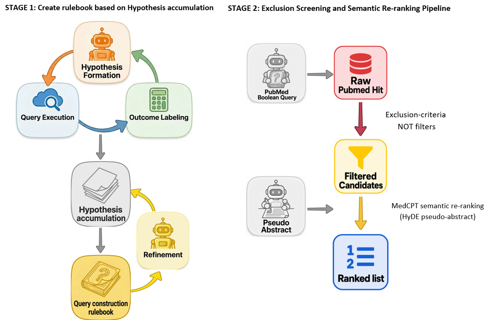

# SR Benchmark — Public Release

Reproducibility package for the paper:  
**"An Agentic Learning Framework for Systematic Review Literature Search"**

Suguru Honda, Rachel Knevel, Erik B van den Akker  
Leiden University Medical Center

---

## Pipeline Overview



**Figure 1.** Overview of the two-stage pipeline. Stage 1 derives a structured Boolean query rulebook through iterative hypothesis accumulation on training SRs (left), then applies it to generate queries for held-out SRs. Stage 2 applies exclusion-criteria-based filtering and MedCPT semantic re-ranking (right).

---

## Directory Structure

```
public_release/
  01_hypothesis_accumulation/          # Stage 1: Iterative hypothesis accumulation pipeline (Codex CLI)
  02_query_laws_refinement/            # Stage 1: Law extraction + iterative rulebook refinement workflow
  03_hypothesis_accumlation_test/      # Stage 1: Query generation & evaluation (Claude / Codex / Gemini)
  04_data/                             # Training SR input configs (11 papers) and model outputs
  05_test_data/                        # Test SR data (24 papers: gold PMIDs, human queries, input configs, model outputs)
  06_exclusion_screening_pipeline/     # Stage 2: Exclusion filtering + MedCPT semantic re-ranking pipeline
  07_paper_figures/                    # Selected figure scripts and historical analysis data
  08_elicit_queryb_dataset/            # Elicit retrieval results and recall computation
  09_openscholar_query_dataset/        # OpenScholar (Asta) retrieval results and recall computation
  revision_reruns/                     # Reviewer-requested analyses added during peer review (rerun reproducibility, cutoff sensitivity, failure cases)
  stageC_harmonized/                   # Revised primary Stage 2 metrics, statistics and sensitivity analyses
  run1_stage2/                         # Historical intermediate files; see limitations in its README
```

See `REPRODUCIBILITY_MAP.md` for the script/data mapping for this release, including historical analyses under `revision_reruns/`.

---

## Quick Start

On Windows, run `git config --global core.longpaths true` before cloning: some historical files under `05_test_data/` have paths longer than 260 characters. To check the deposited Stage C files, run `sha256sum -c MANIFEST.sha256` inside `stageC_harmonized/`.

### 1. Generate a PubMed query for a new SR (Stage 1)

Provide an LLM (Claude / Codex / Gemini) with:
- `02_query_laws_refinement/test_prompt_with.md` — query construction prompt (with rulebook)
- `02_query_laws_refinement/query_laws_ver14.txt` — finalized rulebook (v14, used in paper)
- `05_test_data/{domain}/{paper_id}/input_config.json` — SR objectives and criteria

Evaluate recall via PubMed:
```
(generated_query) AND (PMID1[uid] OR PMID2[uid] OR ...)
```
Gold PMIDs are in `05_test_data/{domain}/{paper_id}/gold_pmids.json`.

### 2. Reproduce hypothesis accumulation (training set)

See `01_hypothesis_accumulation/README.md`.  
Training search histories are in `02_query_laws_refinement/02_input_logs/`.

### 3. Reproduce query law refinement

See `02_query_laws_refinement/WORKFLOW.md` for the full 3-step workflow.

### 4. Reproduce Stage 2 exclusion screening + re-ranking

See `06_exclusion_screening_pipeline/README.md`.

For the revised primary analysis, replay the saved scores offline from the repository root (no GPU, PubMed requests or model calls):

```bash
python stageC_harmonized/code/replay_metrics.py --public-root . --out ../stageC_reproduction/metrics
python stageC_harmonized/code/statistics.py --metrics ../stageC_reproduction/metrics --public-root . --out ../stageC_reproduction/stats
python stageC_harmonized/code/compare_expected.py --metrics ../stageC_reproduction/metrics --stats ../stageC_reproduction/stats
```

See `stageC_harmonized/README.md` for candidate provenance, score components and analysis conditions.

### 5. Reproduce selected figures and historical analyses

Figure 1 is a manually laid-out schematic (no generating script). The following commands generate selected figures. The Stage 2 commands reproduce historical Run1 summaries, not the harmonized Stage 2 primary analysis used in the second revision.

```bash
cd 07_paper_figures/scripts/
python generate_training_figures_v2.py   # Figure 2, Round 2 Figure S2 (historical Figure S1), legend-only panel
python figure3_v4_mean_ci_bar.py ../..   # Figure 3, using the supplied fixed Stage 1 CSVs
python ../clinical_areas/figureS3_unseen_areas_mean_ci_bar.py --release-root ../.. --output-dir ../../../clinical_area_reproduction
# Historical Stage 2 and subgroup renderers (not revised primary figures):
python figure4_v3_mean_ci_bar.py         # Historical Figure 4
python figure4_stage2_boxplot.py         # Figure 4 alternate boxplot view
python figureS2_novel_domains_mean_ci_bar.py  # Round 1 Figure S2 (RA + oncology only)
python gen_selection_flow.py             # Round 2 Figure S1: SR selection flow / gold PMID extraction
python reproduce_stage2_statistics.py        # Historical Stage 2 NNR tests and R_search
python figure5_workload_reduction_forest.py   # Historical Figure 5 (Run1 workload reduction forest plot)
```

For the historical rulebook reproducibility, cutoff-sensitivity and failure-case analyses included in this release, see `REPRODUCIBILITY_MAP.md` for scripts and required inputs. Historical supplementary figure/table labels use Round 1 numbering. The second-revision figure and table numbers, and which of them this release reproduces, are listed in `REPRODUCIBILITY_MAP.md` ("Second-revision (Round 2) numbering").

---

## Datasets

| Set | N | Domains | Purpose |
|---|---:|---|---|
| Training | 11 | CV×3, PSY×3, INF×2, Other×3 | Hypothesis accumulation + rulebook refinement |
| Test | 24 | ONC×7, RH×6, CV×4, PSY×3, INF×2, Other×2 | Benchmark evaluation (held out) |

Clinical-area assignments are provided in `07_paper_figures/clinical_areas/clinical_areas_35reviews.csv`. RH denotes rheumatology; directory names retain historical domain labels. The unseen-area analysis includes RH and ONC (13 test reviews).

---

## Interpreting the analysis files

Stage 1 metrics are stored under `07_paper_figures/data/test24_eval/`. NNR is the number of candidate records divided by the number of retrieved gold-standard studies; it is not a direct measurement of screening time or cost.

The May 2026 Stage 2 aggregate CSVs and their plotting scripts preserve historical Run1 results. They are not the harmonized Stage 2 primary analysis used in the second revision and should not be cited as evidence of demonstrated workload, time or cost savings. `run1_stage2/README.md` describes the provenance and limitations of the preserved article-level files.

---

## Large Data (Zenodo)

The PubMed API response cache (~694 MB, excluded from this repository) is available on Zenodo:

> Honda S, Knevel R, van den Akker EB. *PubMed Cache Data for SR-LLM Query Pipeline Benchmark.* Zenodo, 2026. DOI: [10.5281/zenodo.20392130](https://doi.org/10.5281/zenodo.20392130)

Place the extracted `pubmed_cache/` directory under `06_exclusion_screening_pipeline/` before running Stage 2.
